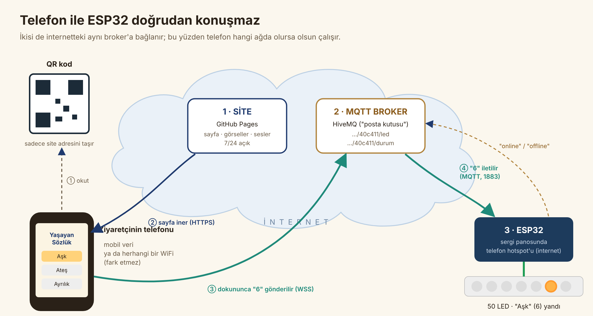

# Yaşayan Sözlük — Sistem Nasıl Çalışıyor?

Ziyaretçi QR kodu okutur, telefonunda sözlük açılır. Bir kelimeye dokunduğunda kelimenin görseli, Arapçası, sesi ve özlü sözü telefonda görünür. Aynı anda sergi panosunda o kelimenin LED'i yanar. Kartı kapatınca LED söner.

Bunu üç parça birlikte yapar.



## 1. Önemli: ESP32 bir sunucu değil

İlk akla gelen fikir şuydu: ESP32 bir web sunucusu açar, QR o sunucuyu açar. Bu yapıyı **kullanmıyoruz**, çünkü:

| Sorun | Açıklama |
|---|---|
| Hafıza | 50 görsel ve 50 ses yaklaşık 15–20 MB eder. ESP32'nin hafızası 4 MB. |
| Aynı ağ zorunluluğu | ESP32 sunucu olsaydı, ziyaretçinin telefonu ESP32'nin bağlı olduğu WiFi'ye bağlanmak zorunda kalırdı. Mobil verideki telefon ESP32'yi göremez. |
| Güvenlik engeli | Tarayıcılar, güvenli (https) bir sayfanın yerel ağdaki `http://192.168.x.x` gibi bir cihaza istek göndermesini engeller. |
| Kalabalık | Aynı anda onlarca telefon küçük bir ESP32'ye bağlanırsa kart yavaşlar ya da kilitlenir. |

**Bunun yerine:**

- **Site:** GitHub'ın ücretsiz sunucularında duruyor ve 7/24 açık.
- **ESP32:** Sadece ışık işini yapıyor.
- **İletişim:** Telefon ile ESP32 doğrudan konuşmuyor. İkisi de internetteki aynı **MQTT broker**'ına bağlanıyor. Broker bir posta kutusu gibi çalışır: telefon mesajı kutuya bırakır, ESP32 kutuyu dinler.

## 2. Bir dokunuşun yolculuğu

| Adım | Ne olur | Süre |
|---|---|---|
| 1 | Ziyaretçi QR'ı okutur. Telefon `…github.io/yasayan-sozluk` adresini açar; sayfa GitHub'dan, fotoğraflar Unsplash'ten iner. | 1–2 sn |
| 2 | Sayfa açılınca telefon broker'a şifreli bir WebSocket bağlantısı kurar (`wss://broker.hivemq.com:8884`). | ~0,5 sn |
| 3 | Broker, ESP32'nin daha önce bıraktığı **"online"** notunu telefona iletir. Sağ üstte yeşil **"Işık bağlı"** yazar. | anında |
| 4 | Ziyaretçi **Aşk**'a dokunur. Kart açılır ve telefon broker'a **"6"** mesajını gönderir (Aşk = 6 numaralı LED). | anında |
| 5 | Broker mesajı, o konuyu dinleyen ESP32'ye iletir. | 50–300 ms |
| 6 | ESP32 mesajı kontrol eder: sayı mı, 0–49 arasında mı, çok sık mı geliyor? Geçerliyse 6 numaralı LED'i 0,6 sn'de yumuşakça yakar. | 0,6 sn |
| 7 | Ziyaretçi kartı kapatır. Telefon **"off:6"** gönderir. ESP32, 6 hâlâ yanıyorsa söndürür. | 0,6 sn |

Ziyaretçi açısından dokunduğu anda ışık yanmış gibi algılanır.

## 3. Telefon başka ağdaysa ne olur?

**Hiçbir fark olmaz.** Telefonun tek şartı **internete çıkabilmesi**. ESP32 ile aynı ağda olması gerekmez.

| Telefonun bağlantısı | Çalışır mı? | Neden |
|---|---|---|
| Mobil veri (4G/5G) | ✅ | Telefon internetteki broker'a, ESP32 de aynı broker'a bağlı. |
| Mekânın WiFi'si | ✅ | Aynı şekilde broker üzerinden. |
| Başka bir WiFi (komşu kafe, otel) | ✅ | İnternet varsa yeter. |
| Yurt dışından, başka şehirden | ✅ | Teknik olarak çalışır. Panodaki ışığı uzaktan yakabilir; konu adı gizli olduğu için pratikte sadece QR'ı okutan kişiler bilir. |
| İnterneti olmayan telefon | ❌ | Sayfa zaten açılmaz. |
| Kurum ağı WebSocket'i engelliyorsa (nadir) | ⚠️ | Sözlük açılır, görsel ve ses çalışır, ama ışık yanmaz ve "Bağlantı yok" yazar. Mobil veriyle çalışır. |

## 4. ESP32 internete nasıl çıkıyor? (telefon hotspot'u)

ESP32, sergideki bir telefonun **mobil hotspot**'una bağlanır. Telefonun mobil verisi, ESP32'nin internet kapısıdır.

```
ESP32 ──(2.4 GHz WiFi)──► Hotspot telefonu ──(4G/5G)──► İnternet ──► MQTT broker
```

- **Hazır ad ve şifre:** Kodda hotspot adı **`YasayanSozluk`**, şifresi **`sozluk2026`** olarak yazılı. Telefonun hotspot'unu bu adla ve şifreyle açmanız yeterli.
- **2.4 GHz:** ESP32 sadece 2.4 GHz ağları görür.
  - Android: Hotspot → Bant: **2.4 GHz**.
  - iPhone: Kişisel Erişim Noktası → **"Uyumluluğu En Üst Düzeye Çıkar"** açık.
- **Veri kullanımı çok az:** ESP32 sadece "6", "off:6" gibi birkaç baytlık mesajlar alır. Görsel ve sesler hotspot'tan geçmez; her ziyaretçi kendi mobil verisini kullanır.
- **Telefon şarjda olsun:** Hotspot pili hızlı tüketir. Otomatik kapanma ayarı varsa kapatın.
- **Kendi kendine toparlanma:** Hotspot kapanıp açılırsa ya da elektrik giderse ESP32 kendiliğinden yeniden bağlanır.
- **Durum ışığı:** Kart üzerindeki mavi LED **sabit** yanıyorsa bağlantı tamam, **yanıp sönüyorsa** yok.
- **Port:** Mobil operatörler ESP32'nin kullandığı 1883 portunu genellikle engellemez. Kurum ağlarına göre hotspot bu açıdan daha sorunsuzdur.
- **Yedek ağ:** İsterseniz `config.h` içinde ikinci sıraya yedek bir WiFi yazılabilir; ESP32 hangisi çekiyorsa ona bağlanır.

## 5. Olası durumlar

| Durum | Ziyaretçi ne görür? |
|---|---|
| Her şey normal | Sözlük, görsel, ses, söz çalışır. Sağ üstte yeşil "Işık bağlı" yazar ve dokununca LED yanar. |
| ESP32 kapalı ya da internetsiz | Sözlük, görsel, ses ve söz **yine çalışır**. Sadece "Işık kapalı" yazar ve LED yanmaz. Bunu broker bildirir: ESP32 bağlıyken bıraktığı vasiyet mesajı (LWT) bağlantı kopunca otomatik yayınlanır. |
| Broker'a ulaşılamıyor | Sözlük yine çalışır. "Bağlantı yok" yazar ve telefon birkaç saniyede bir yeniden dener. |
| İki ziyaretçi aynı anda | Son dokunanın kelimesi yanar. Biri kartını kapatınca sadece **kendi** yaktığı ışık söner; başkasınınkine dokunmaz. |
| Ziyaretçi kartı kapatmadan gider | LED en fazla 60 sn sonra kendiliğinden söner. Telefon kilitlenirse ya da sekme kapanırsa hemen söner. |
| Kötü niyetli ya da hatalı komut | ESP32, 0–49 dışındaki, sayı olmayan ya da saniyede 6'dan sık gelen komutları yok sayar. |

## 6. Mesajlar (teknik)

| Konu (topic) | Gönderen → alan | İçerik | Anlamı |
|---|---|---|---|
| `yasayansozluk/40c411/led` | Telefon → ESP32 | `"0"` … `"49"` | O LED'i yak (0 = Adalet … 49 = Yolculuk) |
| | | `"off:6"` | 6 hâlâ yanıyorsa söndür (kart kapandı) |
| | | `"off"` | Hepsini söndür |
| `yasayansozluk/40c411/durum` | ESP32 → telefonlar | `"online"` / `"offline"` | Işık sistemi açık mı? Broker bu mesajı saklar (retained); sayfayı yeni açan telefon da hemen öğrenir. |

`40c411` bu projeye özel rastgele bir kimliktir. Sitedeki `config.js` ile ESP32'deki `config.h` dosyasında **aynı** olmalıdır.

## 7. Güvenlik ve sergiye geçiş

- **Şu anki broker:** HiveMQ'nun **herkese açık** ücretsiz broker'ı kullanılıyor; hesap gerekmez, test için idealdir.
- **Sınırları:** Erişilebilirlik garantisi yok ve konu adını bilen herkes LED yakabilir. En kötü ihtimalle birinin bir LED yakmasıdır; başka bir şeye erişemez.
- **Sergi için:** Ücretsiz **HiveMQ Cloud** hesabıyla size özel, şifreli bir broker açılabilir. Bunun için sadece `config.js` ve `config.h` içinde adres, kullanıcı adı ve şifre değişir; başka kod değişmez.

## 8. Dosyalar nerede, nasıl güncellenir?

| Ne | Nerede | Nasıl eklenir |
|---|---|---|
| Kelimeler, Arapça, sözler | `sozluk.json` | Metni düzenleyip GitHub'a yükleyin |
| Kelime fotoğrafları | Unsplash (adresleri `sozluk.json` → `foto`) | Hazır. Değiştirmek için Claude'a hangi kelime olduğunu söyleyin. |
| Sesler | `audio/<kelime>.mp3` | Kayıtları sohbete gönderin; hazırlayıp verilir |
| Broker ayarları, görsel modu | `config.js` | |
| ESP32 kodu | Ayrı paket: `esp32-yasayan-sozluk` | Arduino IDE ile karta yüklenir |

Dosya adları `sozluk.json` içindeki `slug` değeriyle aynıdır: Türkçe karakter yok, küçük harf (`alcakgonulluluk.jpg`, `sukur.mp3`). Tam liste `docs/medya_listesi.csv` dosyasındadır.

**GitHub'a yükleme:**

1. Depo sayfasında **Add file → Upload files** deyin.
2. Klasörün içindekileri sürükleyip bırakın.
3. **Commit changes**'a basın.

Site 1–2 dakikada güncellenir; **QR kod hiç değişmez.**

## 9. Test aracı: ESP32 taklitçisi

`…github.io/yasayan-sozluk/esp32-taklit.html` sayfası, gerçek ESP32'nin yaptığının aynısını yapar: broker'a bağlanır ve 50 LED'i ekranda gösterir. Donanım gelene kadar bilgisayarda açık tutup telefonla test edebilirsiniz.

**Gerçek ESP32 bağlandığında bu sayfayı kapatın.** İkisi aynı anda açık olursa "Işık bağlı/kapalı" göstergesi karışır.

## 10. Sorun giderme

| Belirti | Olası sebep | Çözüm |
|---|---|---|
| QR okutunca sayfa açılmıyor | Telefonda internet yok | Mobil veriyi açın |
| "Işık kapalı" yazıyor | ESP32 kapalı, WiFi yok ya da taklitçi kapalı | ESP32'nin fişini ve kart üzerindeki mavi LED'i kontrol edin |
| Mavi LED yanıp sönüyor | ESP32 hotspot'a ya da broker'a bağlanamıyor | Hotspot açık mı, 2.4 GHz mi, adı ve şifresi `YasayanSozluk` / `sozluk2026` mı? Seri Monitör görünen ağları listeler |
| "Işık bağlı" ama LED yanmıyor | Kablolama | BOOT tuşuna basın: LED'ler sırayla yanmalı. Yanmıyorsa DIN, GND ve 5 V bağlantılarına bakın |
| Yanlış kelimenin LED'i yanıyor | Panodaki sıra şeritten farklı | `config.h` → `HARITA_KULLAN 1` ve `LED_HARITASI` tablosu |
| Bir kelimede fotoğraf yerine düz zemin var | Fotoğraf yüklenemedi (internet yavaş) | Sayfayı yenileyin |
| Ses çalmıyor | Telefon sessizde, ya da o kelimenin sesi henüz eklenmedi (hoparlör düğmesi soluk görünür) | Medya sesini açın |
